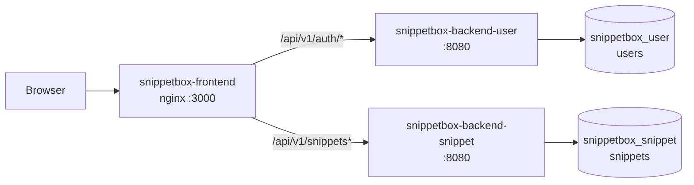
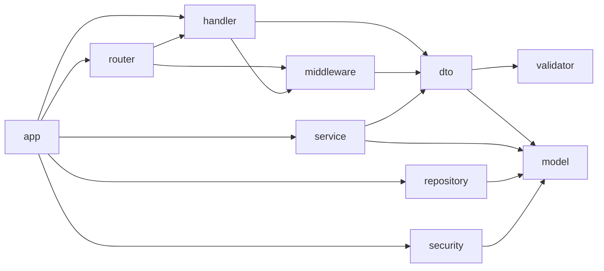

# Snippetbox (Go microservices + React)

A small app for sharing short snippets of text and code that expire on their own, built as **two Go JSON services** (user and snippet) and a **React single-page frontend**, all runnable with Docker Compose.

It is the microservice version of the Snippetbox monolith: the HTTP contract the browser sees is unchanged, but accounts and snippets now live in separate services with separate databases. Each service has its own Go module, Dockerfile and test suites, and can be built and deployed on its own.

The browser talks only to the frontend origin: in Docker, nginx serves the built app and routes `/api/v1/auth/` to the user service and `/api/v1/snippets` to the snippet service, and in development the Vite dev server does the same.

**Stack:** Go 1.27 · Echo v5 · GORM · MySQL 8.4 · JWT · React 19 · TypeScript · Vite · TanStack Query · React Router · Tailwind CSS v4 · Vitest + Testing Library + MSW · Playwright · Docker · GitHub Actions

## Contents

- [Quick start](#quick-start)
- [Features](#features)
- [Configuration](#configuration)
- [Architecture](#architecture)
- [Routes and endpoints](#routes-and-endpoints)
- [Persistence](#persistence)
- [Testing](#testing)
- [CI](#ci)
- [Limits](#limits)
- [References](#references)

## Quick start

Requires Docker. Local development also requires Go 1.27 and Node.js 22.

```sh
cd snippetbox-docker
make docker/up
```

| Service                      | Port | Address                                |
| ---------------------------- | ---- | -------------------------------------- |
| `snippetbox-frontend`        | 3000 | http://localhost:3000                  |
| `snippetbox-backend-user`    | 8080 | http://localhost:8080/api/v1/auth      |
| `snippetbox-backend-snippet` | 8082 | http://localhost:8082/api/v1/snippets  |
| User Swagger UI              | 8080 | http://localhost:8080/swagger/         |
| Snippet Swagger UI           | 8082 | http://localhost:8082/swagger/         |

| Goal                                  | Command                                                                           |
| ------------------------------------- | --------------------------------------------------------------------------------- |
| Run with Docker                       | `make docker/up` (from `snippetbox-docker`)                                       |
| Stop Docker                           | `make docker/down` (from `snippetbox-docker`)                                     |
| Stop Docker and drop data             | `make docker/clean` (from `snippetbox-docker`)                                    |
| Start the development database        | `make docker/dev/up` (from `snippetbox-docker`)                                   |
| Run the user service in development   | `cp .env.example .env && make run` (from `snippetbox-backend-user`)               |
| Run the snippet service in development | `cp .env.example .env && make run` (from `snippetbox-backend-snippet`)           |
| Run the frontend in development       | `npm ci && cp .env.example .env && npm run dev` (from `snippetbox-frontend`)      |
| Run the Go test suites                | `make test/all` (from each backend folder)                                        |
| Run the Vitest suites                 | `npm test` (from `snippetbox-frontend`)                                           |

Local development uses four terminals. The development database (MySQL on `:3306`, phpMyAdmin on `:8081`) comes from `docker-compose.dev.yml`, which creates `snippetbox_user_dev` and `snippetbox_snippet_dev`; both `.env.example` files already point at it. The two services must share the same `JWT_SECRET`, and both examples do. `make run` and `npm run dev` stay in the foreground.

`USER_PORT`, `SNIPPET_PORT` and `FRONTEND_PORT` override the host ports in Docker. The databases live in the `snippetbox-mysql-data` named volume, which `make docker/clean` removes.

## Features

- **Authentication**: sign up, log in, log out, 12-hour sessions backed by a signed JWT, passwords hashed with bcrypt.
- **Snippets**: create a snippet with a title of up to 100 characters and a body that expires after one day, one week or one year (one year by default).
- **Browsing**: the home page lists the 10 latest active snippets, newest first. Each snippet has a public page addressed by its numeric id.
- **Expiry**: expired snippets are hidden from the list and their page and endpoint return `404`.
- **Platform**: flash messages, light and dark theme that follows the system setting, one OpenAPI spec with Swagger UI per service, `/ping` health check on each service.

Snippet titles and content are rendered as plain text, which keeps rendering safe by default without a Markdown or sanitization dependency.

## Configuration

User service (`snippetbox-backend-user/.env`, loaded automatically by the Makefile):

| Variable                 | Default                 | Purpose                                                                             |
| ------------------------ | ----------------------- | ----------------------------------------------------------------------------------- |
| `HTTP_ADDR`              | `:8080`                 | Listen address                                                                      |
| `APP_ENV`                | `development`           | Environment name, reported in the startup log                                       |
| `LOG_LEVEL`              | `info`                  | `debug`, `info`, `warn` or `error`                                                  |
| `DB_DSN`                 | empty                   | Full MySQL DSN; when set, it replaces the `DB_*` variables below                    |
| `DB_HOST`, `DB_PORT`     | `localhost`, `3306`     | MySQL address                                                                       |
| `DB_NAME`, `DB_USER`     | `snippetbox`            | Database and user                                                                   |
| `DB_PASSWORD`            | empty                   | Database password                                                                   |
| `DB_CONNECT_RETRIES`     | `30`                    | Connection attempts at startup, so the service can wait for MySQL                   |
| `DB_CONNECT_RETRY_DELAY` | `2s`                    | Pause between attempts                                                              |
| `JWT_SECRET`             | required                | HS256 signing key, at least 32 characters; generate one with `openssl rand -hex 32` |
| `JWT_TTL`                | `12h`                   | Token lifetime                                                                      |
| `CORS_ALLOWED_ORIGINS`   | `http://localhost:3000` | Comma-separated origins, `*` for all; not needed behind the nginx or Vite proxy     |

Snippet service (`snippetbox-backend-snippet/.env`): the same variables except `JWT_TTL`, which only the user service needs. `JWT_SECRET` must be identical in both services. `HTTP_ADDR` is `:8082` in `.env.example` so that both services can run on one host.

Frontend (`snippetbox-frontend/.env`):

| Variable                     | Default                 | Purpose                                                       |
| ---------------------------- | ----------------------- | ------------------------------------------------------------- |
| `VITE_API_BASE_URL`          | `/api/v1`               | API base URL used by the browser                              |
| `VITE_USER_PROXY_TARGET`     | `http://localhost:8080` | Dev server proxy target for `/api/v1/auth`                    |
| `VITE_SNIPPET_PROXY_TARGET`  | `http://localhost:8082` | Dev server proxy target for `/api/v1/snippets`                |

Docker (`snippetbox-docker/.env`, copied from `.env.example`):

| Variable                                         | Default                                    | Purpose                                         |
| ------------------------------------------------ | ------------------------------------------ | ----------------------------------------------- |
| `MYSQL_ROOT_PASSWORD`                            | see `.env.example`                         | MySQL root password                             |
| `USER_DB_NAME`, `USER_DB_USER`                   | `snippetbox_user`                          | Database and user of the user service           |
| `USER_DB_PASSWORD`                               | see `.env.example`                         | Password of the user service database user      |
| `SNIPPET_DB_NAME`, `SNIPPET_DB_USER`             | `snippetbox_snippet`                       | Database and user of the snippet service        |
| `SNIPPET_DB_PASSWORD`                            | see `.env.example`                         | Password of the snippet service database user   |
| `JWT_SECRET`                                     | `change-me-in-production-0123456789abcdef` | Signing key passed to both services             |
| `CORS_ALLOWED_ORIGINS`                           | `http://localhost:3000`                    | Origins passed to both services                 |
| `USER_PORT`                                      | `8080`                                     | Host port of the user service                   |
| `SNIPPET_PORT`                                   | `8082`                                     | Host port of the snippet service                |
| `FRONTEND_PORT`                                  | `3000`                                     | Host port of the frontend                       |

Every Docker variable has a default, so no environment file is needed locally. Always replace the default `JWT_SECRET` and database passwords outside local use. Database passwords are interpolated into a SQL script at first start, so they must not contain single quotes or `$`.

## Architecture

Snippetbox is three applications that share one HTTP contract. Each backend service is split into layers with one-way dependencies and owns its own data. The frontend is organised by feature, with thin pages on top.

### Services



| Service                      | Owns                                                   | Database             |
| ---------------------------- | ------------------------------------------------------ | -------------------- |
| `snippetbox-backend-user`    | sign up, login, logout, current user; issues JWTs      | `snippetbox_user`    |
| `snippetbox-backend-snippet` | create, read and list snippets; verifies JWTs          | `snippetbox_snippet` |
| `snippetbox-frontend`        | the React app, and the single entry point for `/api/`  | none                 |

The services never call each other and never read each other's tables. The only thing they share is the JWT contract: HS256, issuer `snippetbox`, the user id as subject, a required expiry, and a common `JWT_SECRET`. By default both databases live in one MySQL instance, with one database and one database user per service.

### Project layout

```
snippetbox-backend-user/
  cmd/backend/        entry point, wires configuration, database and server
  docs/               openapi.json and swagger.html, embedded into the binary
  internal/
    app/              composition root: repository, service, handler, router
    config/           environment configuration
    database/         connection with retry, pool settings, auto-migrate of users
    model/            GORM entities and domain rules: User, Token
    dto/              request and response types and input validation
    apperror/         sentinel errors and ValidationError
    validator/        validation helpers
    repository/       GORM data access
    service/          business logic; repository interfaces are declared here
    handler/          HTTP layer; service interfaces are declared here, error mapping
    middleware/       request id, access log, recover, secure headers, CORS, body limit, auth
    router/           routes and the middleware chain
    security/         bcrypt hasher and JWT issuing and verification
    server/           http.Server and graceful shutdown
    testutil/         fakes, fixed clock and SQLite helper for tests
  test/
    integration/      database, repository and services on SQLite
    e2e/              the whole service over HTTP
snippetbox-backend-snippet/
  cmd/backend/        entry point, wires configuration, database and server
  docs/               openapi.json and swagger.html, embedded into the binary
  internal/
    app/              composition root
    config/           environment configuration
    database/         connection with retry, pool settings, auto-migrate of snippets
    model/            GORM entities and domain rules: Snippet, Principal
    dto/              request and response types and input validation
    apperror/         sentinel errors and ValidationError
    validator/        validation helpers
    repository/       GORM data access
    service/          business logic and TokenAuthenticator; interfaces are declared here
    handler/          HTTP layer; service interfaces are declared here, error mapping
    middleware/       request id, access log, recover, secure headers, CORS, body limit, auth
    router/           routes and the middleware chain
    security/         JWT verification
    server/           http.Server and graceful shutdown
    testutil/         fakes, fixed clock, test token issuer and SQLite helper for tests
  test/
    integration/      database, repository and services on SQLite
    e2e/              the whole service over HTTP
snippetbox-frontend/
  src/
    app/              App, providers, routes, query client
    components/       layout and generic UI components
    features/         auth, snippets, flash: api, hooks, components, validation, types
    lib/              API client, errors, session store, validator, date format
    pages/            one component per route
    styles/           global CSS and theme tokens
    test/             setup, MSW server, fake backend, render helpers
  e2e/                Playwright specs, fixtures and helpers
snippetbox-docker/    Dockerfiles, compose files, MySQL init script, Makefile
```

The small packages that both services need (`apperror`, `validator`, `server`, the error and CORS middleware, the error mapping in `handler`) are copied into each service instead of imported from a shared module. That keeps every service buildable from its own folder with its own `go.mod`, at the price of keeping the copies in step by hand.

### Layer dependencies

Arrows point from a package to the package it depends on. The graph is acyclic, and it is the same shape in both services.



### Dependency direction

- `handler` calls `service`, `service` calls `repository`, `repository` works on `model`. Interfaces are declared by the consumer: in the user service `service` declares `UserRepository` and `handler` declares `AuthService`; in the snippet service `service` declares `SnippetRepository` and `TokenVerifier`, and `handler` declares `SnippetService`.
- `handler` and `service` never import each other, and `service` never imports `repository`. Only `app` knows the concrete types.
- `model`, `apperror`, `config` and `server` import nothing else from the application.
- Only `repository` and `database` run queries. Only `security` touches bcrypt and JWT.
- Frontend: `pages` compose `features`; `lib` and `components/ui` never import from `features`; other code imports a feature through its `index.ts`.

### Request flow

- **Routing**: nginx sends `/api/v1/auth/` to the user service and `/api/v1/snippets` to the snippet service. Any other `/api/` path answers `404` in the standard error envelope. In development the Vite proxy applies the same split.
- **Reads**: `GET /api/v1/snippets` and `GET /api/v1/snippets/{id}` are public. The repository filters out expired rows in SQL. An id that is not a number, does not exist or has expired returns `404`.
- **Writes**: a handler decodes the JSON body, rejects unknown fields, and calls a service. The service validates the request and writes through a repository.
- **Errors**: handlers never write error responses. They return the error, and `handler.NewErrorHandler` maps it to a status and the error envelope in one place.
- **Middleware chain**, outermost first: request id, access log, recoverer, secure headers, CORS, body limit (1 MiB). Authenticated routes add the `Auth` middleware, which sets `Cache-Control: no-store`.
- **Frontend**: `apiClient` sends the JWT as a `Bearer` header and maps the error envelope to typed errors. TanStack Query caches reads, and the current user stays cached until logout or until a request is rejected with `401`.

### Authentication and sessions

Passwords are hashed with bcrypt at cost 12. A password is 8 characters minimum and 72 bytes maximum, the bcrypt limit. Emails are trimmed and lower-cased before they are stored or looked up, and a failed login returns the same message whether the email is unknown or the password is wrong.

The user service issues access tokens: HS256 JWTs with issuer `snippetbox`, the user id as subject and an expiry that is required and checked on every request. For its own protected routes (`/auth/me`, `/auth/logout`) the user must still exist in its database for a token to authenticate.

The snippet service only verifies tokens. `service.TokenAuthenticator` checks the signature, issuer, algorithm and expiry against the service clock and returns the user id, without any database or network call. Creating a snippet therefore keeps working while the user service is down, and a token stays valid until it expires even if its account no longer exists.

The frontend keeps the token and its expiry in `localStorage` under `snippetbox:session`. A session counts as expired 5 seconds before its real expiry. Logout is stateless: the server answers `204` and the client drops the token.

### Flash messages

A flash message is held in React state by `FlashProvider`. It is queued on one location, shown on the next one and discarded after that, so it survives exactly one navigation.

## Routes and endpoints

### Pages

| Route               | Purpose                                                      |
| ------------------- | ------------------------------------------------------------ |
| `/`                 | Home with the latest snippets                                |
| `/user/signup`      | Create an account                                            |
| `/user/login`       | Sign in; redirects to `/snippet/create` on success           |
| `/snippet/create`   | Create a snippet; redirects to `/user/login` when signed out |
| `/snippet/view/:id` | A single snippet                                             |
| `*`                 | Not found page                                               |

### API

| Method | Path                    | Service | Auth   | Result                                                 |
| ------ | ----------------------- | ------- | ------ | ------------------------------------------------------ |
| GET    | `/ping`                 | both    | -      | `{"status":"ok"}`                                      |
| GET    | `/swagger/`             | both    | -      | Swagger UI; the spec is at `/swagger/openapi.json`     |
| POST   | `/api/v1/auth/signup`   | user    | -      | `201` with the new user                                |
| POST   | `/api/v1/auth/login`    | user    | -      | `200` with `token`, `token_type`, `expires_at`, `user` |
| POST   | `/api/v1/auth/logout`   | user    | Bearer | `204`                                                  |
| GET    | `/api/v1/auth/me`       | user    | Bearer | The current user                                       |
| GET    | `/api/v1/snippets`      | snippet | -      | The 10 latest active snippets                          |
| GET    | `/api/v1/snippets/{id}` | snippet | -      | An active snippet                                      |
| POST   | `/api/v1/snippets`      | snippet | Bearer | `201` with the snippet and a `Location` header         |

`/ping` and `/swagger/` are served by each service on its own port. Through the frontend origin only the `/api/v1/` routes are reachable.

### Errors

Every error uses one envelope: `{"error":{"code","message","fields","non_field"}}`.

| Status | Code                                     | When                                                    |
| ------ | ---------------------------------------- | ------------------------------------------------------- |
| `400`  | `BAD_REQUEST`                            | Body is not valid JSON or has unknown fields            |
| `401`  | `INVALID_CREDENTIALS`, `UNAUTHENTICATED` | Wrong email or password; missing or bad token           |
| `404`  | `NOT_FOUND`                              | Unknown, malformed or expired snippet id, unknown route |
| `405`  | `METHOD_NOT_ALLOWED`                     | Wrong method for a route                                |
| `413`  | `PAYLOAD_TOO_LARGE`                      | Body larger than 1 MiB                                  |
| `422`  | `VALIDATION_ERROR`                       | Field errors in `fields`, others in `non_field`         |
| `500`  | `INTERNAL_ERROR`                         | Unexpected failure; the cause is only logged            |

`INVALID_CREDENTIALS` is only produced by the user service.

### Validation

| Field           | Rule                                                                      |
| --------------- | ------------------------------------------------------------------------- |
| Name            | Required, at most 255 characters                                          |
| Email           | Required, valid format, at most 255 characters, unique ignoring case      |
| Password        | Required on login; on sign up at least 8 characters and at most 72 bytes  |
| Snippet title   | Required, at most 100 characters (counted as characters, not bytes)       |
| Snippet content | Required, at most 65535 bytes                                             |
| Snippet expiry  | Must equal `1`, `7` or `365` days                                         |

The frontend checks the main rules before sending a request, and the backend remains the source of truth.

## Persistence

Each service creates its own schema at startup with GORM auto-migrate. The connection retries until MySQL is ready, uses `utf8mb4`, parses times in UTC and keeps at most 25 open and 5 idle connections.

| Service | Database             | Table      | Notes                                                                                    |
| ------- | -------------------- | ---------- | ---------------------------------------------------------------------------------------- |
| user    | `snippetbox_user`    | `users`    | unique `email`, stored lower-cased; the password is stored only as a bcrypt hash         |
| snippet | `snippetbox_snippet` | `snippets` | indexed by `created` and `expires`; `content` is a `TEXT` column; ids are auto-increment |

`snippetbox-docker/mysql/init-databases.sh` creates both databases and their users the first time the MySQL container starts. Snippets do not store an author, so the two databases have no relation to each other.

Timestamps are stored and returned in UTC. Listings and lookups filter out expired snippets in SQL and order by id, newest first.

## Testing

### Backend

Both services have the same layers and commands, run from each service folder.

| Layer       | Command                 | What it proves                                                                                                   |
| ----------- | ----------------------- | ---------------------------------------------------------------------------------------------------------------- |
| Unit        | `make test`             | Handlers, services, middleware, router, security, config and validation, with fakes and no database              |
| Race        | `make test/race`        | The unit suites under the race detector                                                                          |
| Integration | `make test/integration` | Auto-migrate, connection retry, repositories, and services on SQLite (real bcrypt and JWT in the user service)   |
| E2E         | `make test/e2e`         | The whole service over HTTP with the production wiring                                                           |

`make test/all` runs every layer and `make test/cover` runs them with a combined coverage profile in `coverage.out`. Integration and e2e tests carry the `integration` and `e2e` build tags.

The token contract between the services is covered from both sides: the user service tests issue and verify tokens, the snippet service tests verify tokens built with the same claims by `testutil.IssueToken` and reject foreign secrets, expired tokens and malformed claims. The Docker job in CI then proves the real pair end to end.

### Frontend

| Layer         | Command                    | What it proves                                                                                       |
| ------------- | -------------------------- | ---------------------------------------------------------------------------------------------------- |
| Unit          | `npm run test:unit`        | Validation, API layer, errors, session store, flash state and presentational components              |
| Integration   | `npm run test:integration` | Real pages, router and TanStack Query, with the network replaced by MSW on top of a fake backend     |
| E2E (browser) | `npm run test:e2e`         | Playwright journeys in Chromium against the dev server, with the API mocked by the same fake backend |

`npm test` runs the first two layers. `npm run test:coverage` adds V8 coverage with thresholds of 95% statements, 90% branches, 95% functions and 95% lines. `npm run test:all` runs everything, including the browser suite.

Install Playwright's browser once with `npx playwright install chromium`. To reuse an existing Chromium, set `PLAYWRIGHT_CHROMIUM_PATH`.

### Conventions

- Backend integration and e2e tests use in-memory SQLite (`glebarez/sqlite`, no cgo) instead of MySQL, and a fixed clock makes expiry exact at the boundary.
- Services are tested against fake repositories and handlers against fake services, because each consumer declares its own interfaces.
- Browser tests block every request to another origin, mock the API at the network level and freeze time.
- Source, tests and configuration contain no code comments; names carry the intent.

## CI

`.github/workflows/ci.yml` runs these jobs:

1. **Commit messages**: commit message linting on pull requests. Scopes are `backend`, `frontend`, `docker`, `ci`, `deps`, `snippet` and `user`.
2. **Backend quality**: runs once per service (`user`, `snippet`) as a matrix: module verification, `gofmt`, `go vet`, unit tests with the race detector, integration and e2e tests, then the coverage run, which is uploaded as an artifact per service.
3. **Backend build**: static binary build of each service.
4. **Frontend quality**: lint, typecheck, unit and integration tests, then the coverage run, which is uploaded as an artifact.
5. **Frontend build**: production build.
6. **Frontend E2E**: the Playwright suite in Chromium. It starts the dev server itself, and uploads the report and traces when it fails.
7. **Docker**: the three images are built with layer caching, started with Compose, and checked by waiting for `/ping` on both services, requesting each service's documentation, the frontend pages, and running a signup, login, `me` and snippet round trip through the nginx proxy. That round trip creates a snippet with a token issued by the user service, which also proves the two services agree on the JWT contract. It also checks that each service answers `404` for the other's routes, and that missing or invalid tokens are rejected with `401`.

## Limits

- One MySQL instance hosts both databases by default; the schemas are managed by auto-migrate, not versioned migration files. Auto-migrate runs at every start, so run a single replica per service until migrations move out of startup.
- Tokens are stateless, so logout cannot revoke a token before it expires, and the snippet service cannot tell that an account was removed.
- Both services trust one shared symmetric secret. Whoever holds `JWT_SECRET` can mint tokens for any user; rotating it signs everyone out.
- Shared helper packages are copied into each service, not imported from a common module.
- The token lives in `localStorage`, which is readable by any script running on the page.
- Expired snippets are hidden but never deleted, and snippets cannot be edited or deleted by their authors.
- There is no rate limiting on login or sign up, no password reset and no email verification.
- Backend integration and e2e tests run on SQLite, so MySQL-specific behavior such as collation, column types and driver error messages is not covered.

## References

- [Echo](https://echo.labstack.com/docs) – HTTP framework
- [GORM](https://gorm.io/docs/) · [MySQL documentation](https://dev.mysql.com/doc/)
- [golang-jwt](https://github.com/golang-jwt/jwt) · [bcrypt](https://pkg.go.dev/golang.org/x/crypto/bcrypt)
- [OpenAPI Specification](https://spec.openapis.org/oas/latest.html) · [Swagger UI](https://swagger.io/tools/swagger-ui/)
- [React](https://react.dev) · [Vite](https://vite.dev) · [TanStack Query](https://tanstack.com/query/latest) · [React Router](https://reactrouter.com) · [Tailwind CSS](https://tailwindcss.com/docs)
- [Vitest](https://vitest.dev) · [Testing Library for React](https://testing-library.com/docs/react-testing-library/intro/) · [MSW](https://mswjs.io) · [Playwright](https://playwright.dev)
- [Go: testing](https://pkg.go.dev/testing) · [Go: build constraints](https://pkg.go.dev/cmd/go#hdr-Build_constraints)
- [Docker multi-stage builds](https://docs.docker.com/build/building/multi-stage/) · [Docker Compose](https://docs.docker.com/compose/)
- [nginx: proxy_pass](https://nginx.org/en/docs/http/ngx_http_proxy_module.html#proxy_pass)
- [MDN: Web Storage API](https://developer.mozilla.org/en-US/docs/Web/API/Web_Storage_API)
- [Conventional Commits](https://www.conventionalcommits.org/) – commit message format enforced by commitlint
